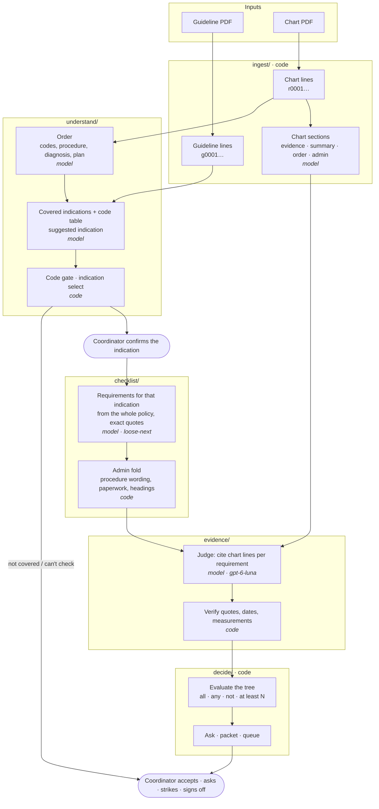

# Architecture

One check = one chart against one payer guideline. The model reads, a person judges, code executes: every model
output is a citation (a line id in the chart or the guideline) that code resolves and checks before anything is shown.

## Steps

| Step | Package | Model or code | What it does |
|---|---|---|---|
| Lines | `ingest/spans.py` | code | One id per extracted line, verbatim, for both documents. Everything later cites these ids. |
| Sections (A2) | `ingest/sections.py` | model | Labels chart sections; the judge may only cite *evidence* lines (not summaries or the order block). |
| Order (B) | `understand/order.py` | model | Codes, procedure, diagnosis, plan read from the chart; codes not printed in the chart are dropped. |
| Indications (C) | `understand/narrow.py` | model | Payer, code table (covered / non-covered / investigational), covered indications with quoted headings, a suggestion. |
| Gate (E–G) | `understand/select.py` | code | Non-covered code stops the check; otherwise the coordinator confirms the indication. |
| Requirements (H) | `checklist/criteria.py`, `reduce_next.py` | model (gpt-6-sol) | Every condition that limits approval for the confirmed indication, read from the **whole** policy (limits often live in other sections), as quotes plus AND / OR / NOT logic. |
| Admin fold | `checklist/admin.py` | code | Procedure wording, paperwork and headings folded under "Not asked of the chart", restorable with one click. |
| Judge (I) | `evidence/judge.py` | model (gpt-6-luna) | One call, all requirements, whole evidence set; returns for / against line ids. |
| Verify (J) | `evidence/judge.py`, `refs.py` | code | Quotes must resolve; dates and durations come from note headings and signatures; measurements must be printed in the cited lines. |
| Decide (K–L) | `decide/` | code | Compiles the tree, builds the ask and the packet, routes to a queue. |
| Review | `review/` | person | Coordinator accepts, asks, strikes (with a reason) and signs off. Nothing is auto-approved. |

## Design choices and why

- **Citations, not text.** The model returns line ids; code copies the words and checks them. The model never types
  what the coordinator reads.
- **Whole policy for step H.** An indication's conditions are spread across the policy (exclusions in reimbursement,
  definitions, "criteria above"). Reading only the indication's own section was v1.1's design and its main source of
  missed requirements.
- **Indication confirmed by a person.** The model suggests; the coordinator confirms, then step H runs on that one
  indication.
- **A person judges.** No automatic "met" checks: the coordinator accepts each item, because no reader can guarantee
  zero false approvals.
- **Caching.** Requirements are cached per guideline + confirmed indication + order facts + model + prompt version, so
  two orders on the same section never share a checklist; chart sections are cached per chart.
- **Evaluation.** Step H is scored against answer keys with an exact solver; see [EVALS.md](EVALS.md).
